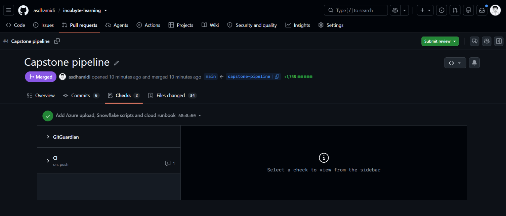
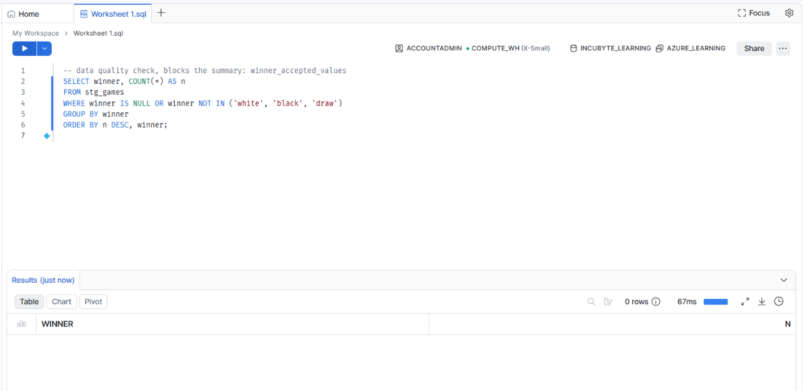
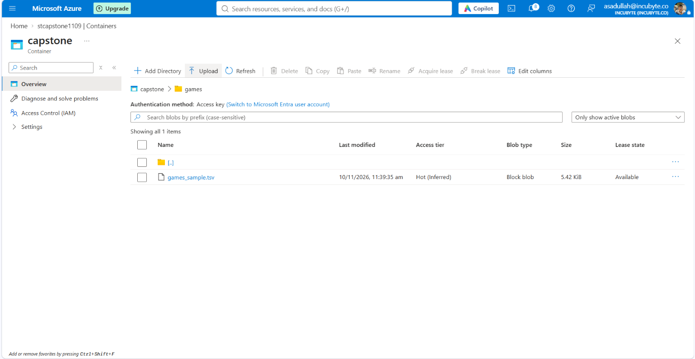
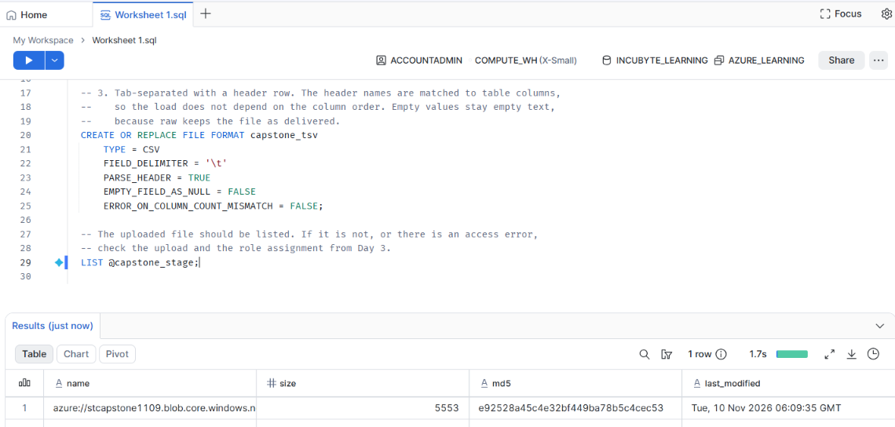
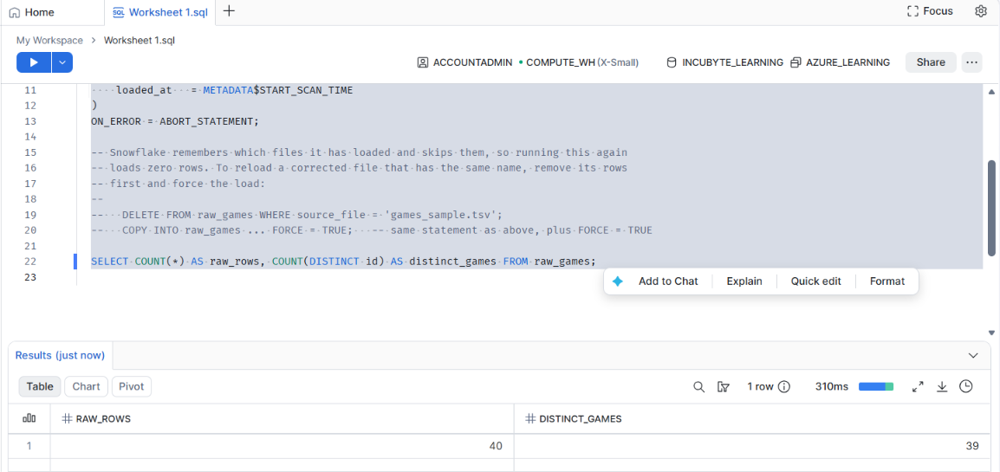
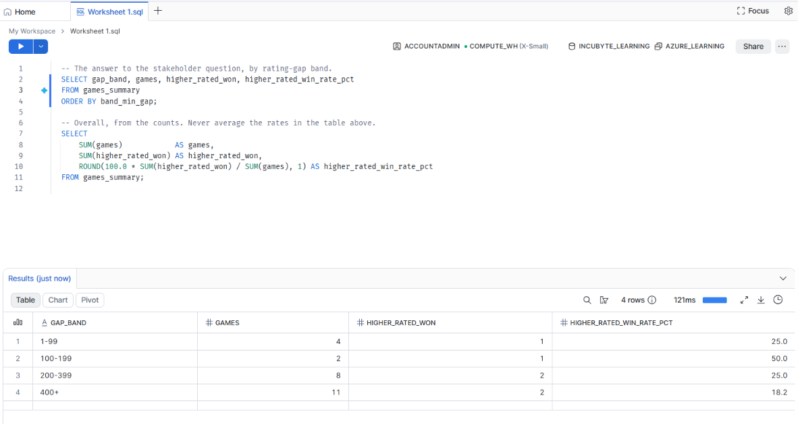
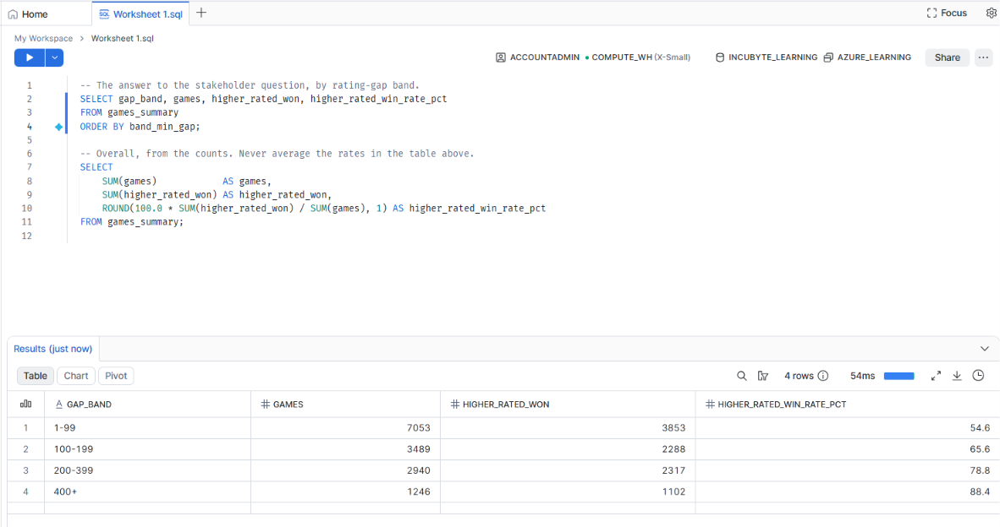

# Part 1 · Day 10 — Capstone: An End-to-End Pipeline

**Date completed:** 2026-11-10 · **Time spent:** ~5 hours
## Success criteria
| Criterion (copied from the planner) | Done? | Evidence (link or section below) |
| ----------------------------------- | ----- | -------------------------------- |
| Builds an end-to-end pipeline from Blob Storage to Snowflake | Yes | [Architecture](#architecture), [Cloud run](#cloud-run), [runbook](../code/part1/day10/capstone/docs/runbook_cloud.md); the sample file was landed, loaded, checked and summarised in Snowflake |
| Tests the pipeline and runs tests in CI through a pull request | Yes | [How it was built](#how-it-was-built-test-first), [Tests and CI](#tests-and-ci), [pull request #4](https://github.com/asdhamidi/incubyte-learning/pull/4) merged with a green check, [screenshot](../assets/day10/pr_checks_green.png) |
| Adds a data quality check with a failure plan | Yes | [Data quality check](#data-quality-check-and-failure-plan), [failure plan](../code/part1/day10/capstone/docs/dq_failure_plan.md), [tests](../code/part1/day10/capstone/tests/test_dq.py) |
| Answers a stakeholder question with a clear metric definition | Yes | [The question and the metric](#the-question-and-the-metric), [metric definition](../code/part1/day10/capstone/docs/metric_definition.md), [The stakeholder answer](#the-stakeholder-answer), [screenshot](../assets/day10/summary_real.png) |
| Writes a comprehensive reflection | Pending | [Reflection on the two weeks](#reflection-on-the-two-weeks) |

## Key learnings
## Exercises
## Reflection
## AI use
- Built the capstone step by step with Claude Code, test-first: each step's tests were written and seen failing before the code existed.
- The cloud steps (the upload and the Snowflake load) were run by me in my own accounts.
## Open questions
## Changes after review

---
## Notes

### The question and the metric
**Do higher-rated players actually win more games, and how does that change as the rating gap grows?** It is the kind of question a ratings or matchmaking owner asks, and it needs a precise definition before any SQL.

The metric is `higher_rated_win_rate_by_gap_band`, the share of decided rated games won by the higher-rated player, split into four bands of rating gap (1-99, 100-199, 200-399, 400+). Full definition: [metric_definition.md](../code/part1/day10/capstone/docs/metric_definition.md).
- Rated games only. Draws are left out, and so are games where both ratings are equal. A game delivered twice counts once.
- The game count sits next to every rate, since small bands are noisy.
- The definition has a worked example of six rows checked by hand, and a test runs the same six rows through the whole pipeline and gets the same result.
- The sample file is synthetic, so its rates mean nothing. Only the real Lichess file can answer the question.

### Architecture
```text
Lichess games file (TSV)
   -> Azure Blob Storage          container `capstone`, folder `games/`
   -> Snowflake external stage    storage integration, COPY INTO
   -> RAW_GAMES                   the file as delivered, plus file name, line and load time
   -> STG_GAMES                   one row per game, typed
   -> GAMES_SUMMARY (view)        higher-rated win rate by rating-gap band
```

| Layer | Holds | Rules |
|---|---|---|
| Raw | The file as delivered, all text | No logic. Never edited |
| Staging | One row per game, with real types | Dedupe, casts and renames only |
| Summary | A view with one row per rating-gap band | The metric rules live here and only here |
- Design notes: [design.md](../code/part1/day10/capstone/docs/design.md).

### How it was built, test-first
Each step started with tests that failed, then the code that made them pass, then a check that the tests catch a deliberate break.

| Step | What | Tests |
|---|---|---|
| Contract | Validator for the file: the columns and types the pipeline reads, and a gate that stops a bad file before anything loads | 14 |
| Raw and staging | Raw load that replaces a file's rows on reload, and staging that dedupes with a unique tie-breaker | 14 |
| Data tests | Six checks on staging (not null, unique, ratings positive, row counts match raw), each also run against a planted bad row to prove it can fail | 13 |
| Summary | The metric, with boundary tests on every band edge, and a cross-check against the metric worked out in plain Python | 22 |
| Data quality check | The `winner` check, and the pipeline that puts staging back to its last good version when it fails | 14 |
| Cloud steps | Upload that checks the contract first, and guards that keep the Snowflake scripts in line with the tested code | 14 |

- 92 tests in the capstone, and 154 across the repo in CI.
- Mutation checks, done by breaking the code on purpose: removing the dedupe failed 6 tests, including the draws in the metric failed 4, skipping the contract gate failed 2, and skipping the rollback of staging failed 2 tests. One test of mine was too weak at first, and a mutation check showed it.
- Two problems came up from CI and not from my own tests. The capstone's tests read their sample file relative to the working directory, which fails when CI runs from the repo root. And a module named `pipeline` clashed with Day 2's, so the capstone code moved into a `games_pipeline` package.

### Tests and CI
| Test | What it protects | When |
|---|---|---|
| Contract | The file still has the columns and types the pipeline reads | Before the load |
| Component | Each SQL step on small fixtures, including the worked example | Every push |
| Data | Not null, unique, positive ratings, row counts match raw | After staging |
| Data quality check | `winner` is one of white, black, draw | Every load |

- `python ci.py` runs four stages in order: no data files committed, format, lint, tests. GitHub Actions runs the same command on every push.
- Work went on the branch `capstone-pipeline` in six small commits, one per step, so each can be reverted on its own.
- I ran CI on a clean checkout of the branch before pushing, so nothing the branch needs is untracked or ignored.
- The branch went in as [pull request #4](https://github.com/asdhamidi/incubyte-learning/pull/4) with its six commits. The `CI / test` check passed on the branch and again on `main` after the merge.



*Pull request #4 with six commits, merged after the checks passed.*

### Data quality check and failure plan
The check is `winner_accepted_values`. In staging, `winner` must be `white`, `black` or `draw`, and never NULL. It matters because the summary only counts `white` and `black`, so a new spelling would drop games out of the metric without any error. This is the same silent failure as the `complete` status on Day 6. The check blocks the summary.

Tests cover an unknown value, a different case, NULL, an empty string, the summary staying unchanged after a failure, staging being put back to its last good version, the rejected build being kept, and a rerun with a fixed file recovering. Full plan: [dq_failure_plan.md](../code/part1/day10/capstone/docs/dq_failure_plan.md).



*The check run in Snowflake on the loaded data: no unexpected `winner` values.*

### Cloud run
The sample file was landed in Blob Storage, staged in Snowflake and loaded into `raw_games`, and the numbers matched the local run.



*The file in Blob Storage, under `capstone/games/`.*



*The Snowflake stage can see the file.*



*The load: 40 raw rows and 39 distinct games, as expected (one game is delivered twice).*



*The summary for the sample file in Snowflake: 25 games in four bands (25.0, 50.0, 25.0 and 18.2), the same numbers as the local run.*

### The stakeholder answer
The real Lichess file (`games/games.csv`, 20,058 rows) was loaded into `raw_games`, staged and summarised in Snowflake with the same SQL the tests run.



*The summary for the real file: 14,728 decided rated games in four rating-gap bands.*

| Rating gap | Games | Won by the higher-rated player | Rate |
|---|---|---|---|
| 1-99 | 7,053 | 3,853 | 54.6% |
| 100-199 | 3,489 | 2,288 | 65.6% |
| 200-399 | 2,940 | 2,317 | 78.8% |
| 400+ | 1,246 | 1,102 | 88.4% |
| All | 14,728 | 9,560 | 64.9% |

The answer, in three sentences:

> Yes: the higher-rated player wins about 65% of decisive rated games (64.9% of 14,728), and the advantage grows with the gap, from 54.6% when the ratings are within 99 points to 88.4% when they are 400 or more apart. Each band holds over a thousand games and the rate rises steadily across all four, so the pattern is not noise. This counts only rated games with a decisive result (draws, unrated games and games between equal ratings are left out), and it shows that ratings predict results, not why, and the wide bands hide differences inside each band.

The overall rate is worked out from the counts (9,560 of 14,728), not by averaging the four rates.

---
## Reflection on the two weeks
Looking back over the two weeks, the thing that changed most was how I start. Before, I started from the code. Now I start from the question and the definition, and I write the expected result by hand before I write any SQL. The metric framework from the analytics day and the test-first approach from the testing day ended up being the same habit: say exactly what the right answer is, then build until the pipeline agrees.

A lot of the early days were refreshers that I understood better by doing them again. Idempotency, late-arriving data and the traps in MERGE and set operators were familiar, but writing the tests for them showed me how easily a result can look right and be wrong. The AWS-to-Azure mapping carried over well: Glue and Step Functions became Data Factory, S3 became Blob Storage. The part that did not map one to one was IAM and the way Azure organises tenants, subscriptions and role assignments. That showed up again in this capstone when the Snowflake app needed its own role on a new storage account.

I had set up data quality checks before, but I had not tested them properly. Building them test-first, with a planted bad row for every check, and writing down what happens when one fails, made them much more trustworthy. The same goes for CI. I had used it before without setting it up myself, and having CI catch two problems that my own tests missed (a path that only worked from one folder, and a module name clash) was the best argument for it.

Where I still want to grow:
- Cloud permissions across the two clouds, especially IAM, which I still cannot translate in my head the way I can with storage and orchestration.
- Building and testing real models in dbt, which so far I know from notes and a project layout, not from a project of my own.
- Power BI measures. My first report counted cancelled orders because it used plain sums, and I would like to build the measures that carry the metric definition.
- Writing answers for stakeholders faster. The definition and the checks are slow the first time, and I want them to become a template I reuse.
