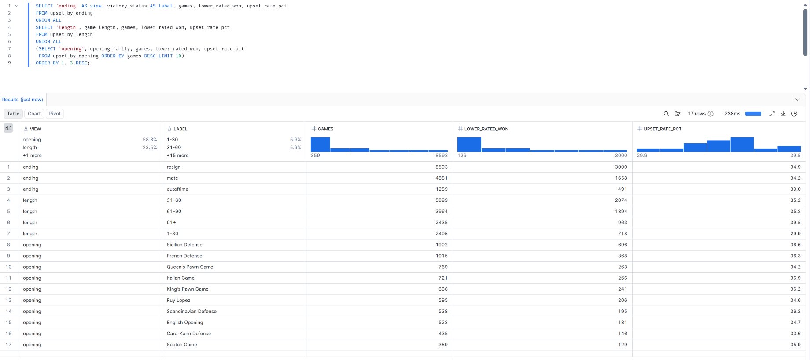

# Part 1 · Day 10 — Capstone: An End-to-End Pipeline

**Date completed:** 2026-11-10 · **Time spent:** ~5 hours
## Success criteria
| Criterion (copied from the planner)                            | Done? | Evidence (link or section below)                                                                                                                                                                                                            |
| -------------------------------------------------------------- | ----- | ------------------------------------------------------------------------------------------------------------------------------------------------------------------------------------------------------------------------------------------- |
| Builds an end-to-end pipeline from Blob Storage to Snowflake   | Yes   | [Architecture](#architecture), [Cloud run](#cloud-run), [One command](#one-command-from-local-file-to-summary), [runbook](../code/part1/day10/capstone/docs/runbook_cloud.md)                                              |
| Tests the pipeline and runs tests in CI through a pull request | Yes   | [How it was built](#how-it-was-built-test-first), [Tests and CI](#tests-and-ci), [pull request #4](https://github.com/asdhamidi/incubyte-learning/pull/4) merged with a green check, [screenshot](../assets/day10/pr_checks_green.png)      |
| Adds a data quality check with a failure plan                  | Yes   | [Data quality check](#data-quality-check-and-failure-plan), [failure plan](../code/part1/day10/capstone/docs/dq_failure_plan.md), [tests](../code/part1/day10/capstone/tests/test_dq.py)                                                    |
| Answers a stakeholder question with a clear metric definition  | Yes   | [The question and the metric](#the-question-and-the-metric), [metric definition](../code/part1/day10/capstone/docs/metric_definition.md), [The stakeholder answer](#the-stakeholder-answer), [screenshot](../assets/day10/summary_real.png) |
| Writes a comprehensive reflection                              | Yes   | [Reflection on the two weeks](#reflection-on-the-two-weeks)                                                                                                                                                                                 |

## Key learnings
## Exercises
- Creating a pipeline over Azure and Snowflake for a lichess data set to answer an interesting question of whether higher rated players beat lower rated players or not, if yes, what is the trend
## Reflection
- It was a fun exercise to learn how to set it all up and to actually get an answer from a real dataset.
## AI use
- Built the capstone's scaffolding with Claude Code
- The cloud steps (the upload and the Snowflake load) were run by me in my own accounts.
- Also built the one-command runner, the log and the upset views with Claude Code, test-first.
## Open questions
NA
## Changes after review
NA

---
## Notes

### The question and the metric
**Do higher-rated players actually win more games, and how does that change as the rating gap grows?** It is the kind of question a ratings or matchmaking owner asks, and it needs a precise definition before any SQL.

The metric is `higher_rated_win_rate_by_gap_band`, the share of decided rated games won by the higher-rated player, split into four bands of rating gap (1-99, 100-199, 200-399, 400+). Full definition: [metric_definition.md](../code/part1/day10/capstone/docs/metric_definition.md).
- Rated games only. Draws and games with equal ratings are left out. A game delivered twice counts once.
- The game count sits next to every rate, since small bands are noisy.
- A worked example of six rows, checked by hand, runs through the whole pipeline in a test and gives the same result.
- The sample file is synthetic, so only the real file can answer the question.

### Architecture
```text
Lichess games file (CSV)
   -> Azure Blob Storage          container `capstone`, folder `games/`
   -> Snowflake external stage    storage integration, COPY INTO
   -> RAW_GAMES                   the file as delivered, plus file name, line and load time
   -> STG_GAMES                   one row per game, typed
   -> GAMES_SUMMARY (view)        higher-rated win rate by rating-gap band
   -> UPSET_BY_OPENING, UPSET_BY_ENDING, UPSET_BY_LENGTH (views)
                                  how often the lower-rated player wins
```

| Layer | Holds | Rules |
|---|---|---|
| Raw | The file as delivered, all text | No logic. Never edited |
| Staging | One row per game, with real types | Dedupe, casts and renames only |
| Summary | A view with one row per rating-gap band | The metric rules live here and only here |
| Upset views | Three views by opening, ending and length | Same rules as the summary, so they count the same games |
- The data is the Kaggle "Chess Game Dataset (Lichess)" (`games.csv`, 20,058 games).
- Design notes: [design.md](../code/part1/day10/capstone/docs/design.md).

### How it was built, test-first
Each step started with tests that failed, then the code that made them pass, then a check that the tests catch a deliberate break.

| Step | What | Tests |
|---|---|---|
| Contract | Validator for the file: the columns and types the pipeline reads, and a gate that stops a bad file before anything loads | 14 |
| Raw and staging | Raw load that replaces a file's rows on reload, and staging that dedupes with a unique tie-breaker | 14 |
| Data tests | Six checks on staging (not null, unique, ratings positive, row counts match raw), each also run against a planted bad row to prove it can fail | 13 |
| Summary | The metric, with boundary tests on every band edge, and a cross-check against the metric worked out in plain Python | 22 |
| Data quality check | The `winner` check, and the pipeline that puts staging back to its last good version when it fails | 14 |
| Cloud steps | Upload that checks the contract first, and guards that keep the Snowflake scripts in line with the tested code | 14 |
| Runner | One command for the cloud steps, tested against a fake Snowflake connection | 57 |
| Upset views | Three views of when the lower-rated player wins, checked against the summary | 37 |


### Tests and CI
| Test | What it protects | When |
|---|---|---|
| Contract | The file still has the columns and types the pipeline reads | Before the load |
| Component | Each SQL step on small fixtures, including the worked example | Every push |
| Data | Not null, unique, positive ratings, row counts match raw | After staging |
| Data quality check | `winner` is one of white, black, draw | Every load |

- `python ci.py` runs four stages in order: no data files committed, format, lint, tests. GitHub Actions runs it on every push.
- Work went on the branch `capstone-pipeline` in six small commits, one per step, so each can be reverted on its own.
- I ran CI on a clean checkout before pushing, so nothing the branch needs is untracked.
- It went in as [pull request #4](https://github.com/asdhamidi/incubyte-learning/pull/4). The `CI / test` check passed on the branch and again on `main` after the merge.


*Pull request #4 with six commits, merged after the checks passed.*

### Data quality check and failure plan
The check is `winner_accepted_values`: in staging, `winner` must be `white`, `black` or `draw`, never NULL. The summary only counts `white` and `black`, so a new spelling would drop games out of the metric without any error, the same silent failure as the `complete` status on Day 6. A failure blocks the summary.

Tests cover an unknown value, a different case, NULL, an empty string, the summary staying unchanged, staging being put back, the rejected build being kept, and a rerun with a fixed file recovering. Full plan: [dq_failure_plan.md](../code/part1/day10/capstone/docs/dq_failure_plan.md).


*The check run in Snowflake on the loaded data: no unexpected `winner` values.*

### Cloud run
The sample file was landed in Blob Storage, staged in Snowflake and loaded into `raw_games`, and the numbers matched the local run.


*The file in Blob Storage, under `capstone/games/`.*


*The Snowflake stage can see the file.*


*The load: 40 raw rows and 39 distinct games, as expected (one game is delivered twice).*

The sample was tab-separated then. It is a CSV now, like the real file.


*The summary for the sample file in Snowflake: 25 games in four bands (25.0, 50.0, 25.0 and 18.2), the same numbers as the local run.*

### One command from local file to summary
The cloud steps above were run by hand. They are now one command from the local file to the summary:

```text
python -m games_pipeline.snowflake_run --local-file games.csv --storage-account <storage-account>
```

In order, it:
1. checks the file against the contract
2. uploads it to Blob Storage
3. creates the Snowflake file format and the stage
4. loads it into `raw_games` in one transaction, which rolls back on an error
5. keeps the last good staging and rebuilds `stg_games`
6. runs the data quality check, and on a failure puts staging back and stops
7. builds the summary and the upset views, and prints them

- The storage integration is set up once by an admin and is not part of the command.
- Sign-in settings come from my own environment variables, never from the repo. My account has no browser sign-in, so it uses a password typed into my own terminal, and it is never logged.
- Progress prints as short lines: `>` a step started, `+` done with its time, `!` a warning, `x` an error.
- It is tested against a fake Snowflake connection, so CI needs no account.
- The real file broke my first contract. I had assumed tabs, `True` and `False`, and whole-number timestamps. It has commas, `TRUE` and `FALSE`, and values like `1.50421E+12`. The contract caught it before anything loaded, and I made the pipeline accept the file as it comes instead of converting it.

### The stakeholder answer
The real file (`games/games.csv`, 20,058 rows) was loaded, staged and summarised in Snowflake with the same SQL the tests run. The local DuckDB run gives the same numbers on every row.

| Rating gap | Games | Won by the higher-rated player | Rate |
|---|---|---|---|
| 1-99 | 7,049 | 3,852 | 54.6% |
| 100-199 | 3,487 | 2,287 | 65.6% |
| 200-399 | 2,932 | 2,315 | 79.0% |
| 400+ | 1,235 | 1,100 | 89.1% |
| All | 14,703 | 9,554 | 65.0% |

The answer, in three sentences:

> Yes: the higher-rated player wins about 65% of decisive rated games (65.0% of 14,703), and the advantage grows with the gap, from 54.6% when the ratings are within 99 points to 89.1% when they are 400 or more apart. Each band holds over a thousand games and the rate rises steadily across all four, so the pattern is not noise. This counts only rated games with a decisive result (draws, unrated games and games between equal ratings are left out), and it shows that ratings predict results, not why, and the wide bands hide differences inside each band.

The overall rate is worked out from the counts (9,554 of 14,703), not by averaging the four rates.


*The summary for the real file in Snowflake: 14,703 decided rated games in four bands.*

### When does the lower-rated player win?
A follow-up. Three views over the same decided games show how often the lower-rated player wins, by opening, by how the game ended and by game length. Each counts exactly the games the summary counts, and a test checks it. Overall, the lower-rated player wins 35.0% of the 14,703 games.

| How the game ended | Games | Won by the lower-rated player | Rate |
|---|---|---|---|
| Resign | 8,593 | 3,000 | 34.9% |
| Mate | 4,851 | 1,658 | 34.2% |
| Out of time | 1,259 | 491 | 39.0% |

| Game length (moves by both players) | Games | Won by the lower-rated player | Rate |
|---|---|---|---|
| 1-30 | 2,405 | 718 | 29.9% |
| 31-60 | 5,899 | 2,074 | 35.2% |
| 61-90 | 3,964 | 1,394 | 35.2% |
| 91+ | 2,435 | 963 | 39.5% |



*The three upset views in Snowflake: how the game ended, game length and the ten most played openings.*

- **Opening:** it barely matters. The ten most played all sit between 34% and 37%.
- **Ending:** upsets are most common when the game ends on time, when a lower-rated player can win a lost position on the clock.
- **Length:** upsets get more common as games get longer.
- These are associations, not causes, and small openings are noisy, so read the count before the rate. Rules: [metric_definition.md](../code/part1/day10/capstone/docs/metric_definition.md).

---
## Reflection on the two weeks
Looking back over the two weeks, the thing that changed most was how I start. Before these two weeks, I started from the code with a rough idea of what I wanted to do and went in that direction. Now I start from the question and the definition, and I write the expected result by hand before I write any SQL or Python. The metric framework from the analytics day and the test-first approach from the testing day ended up being the same habit.

A lot of the early days were refreshers that I understood better by doing them again. Idempotency, late-arriving data and the traps in MERGE and set operators were familiar, but writing the tests for them showed me how a result can look right and be wrong. The AWS-to-Azure mapping was a good learning exercise in creating a mental dictionary of what I knew in AWS to Azure. I feel I have much better command over Azure now than I did two weeks back.

I had set up data quality checks before, but I had not tested them properly. Building them test-first, with a planted bad row for every check, and writing down what happens when one fails, made them much more trustworthy. The same goes for CI. I had used it before without setting it up myself.

Where I still want to grow:
- Cloud permissions across the two clouds, especially IAM, which I still cannot translate in my head the way I can with storage and orchestration.
- Building and testing real models in dbt, which so far I know from notes and a project layout, not from a project of my own.
- Writing answers for stakeholders faster. The definition and the checks are slow the first time, and I want them to become a template I reuse.
- To be able to communicate clear and well when failures happen and to be able to do a blameless postmortem.
