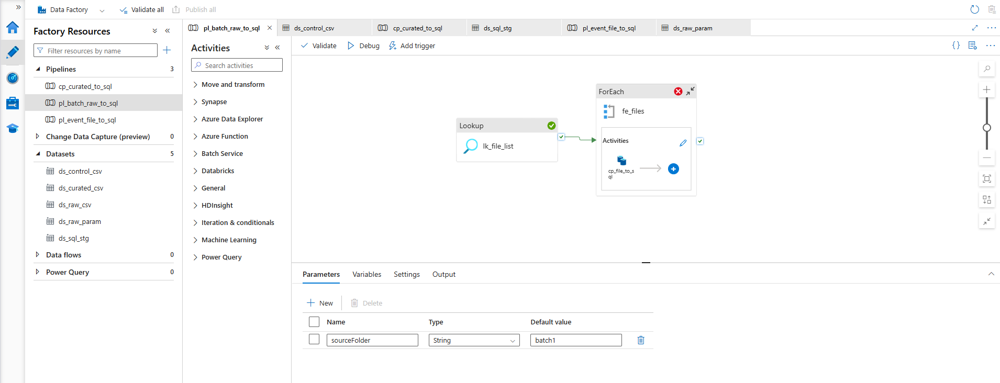
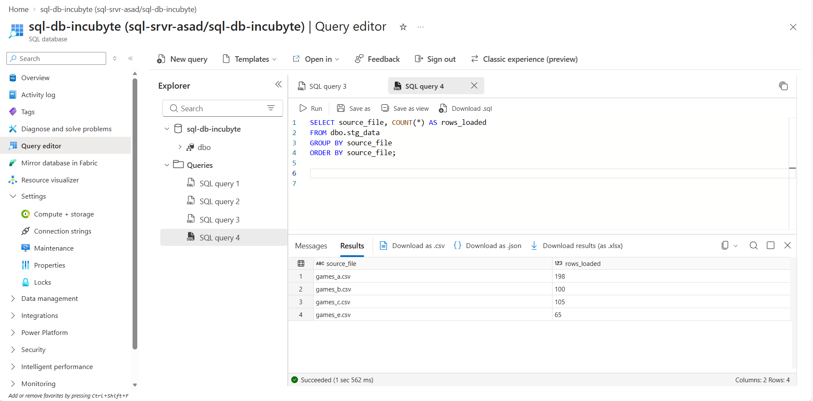
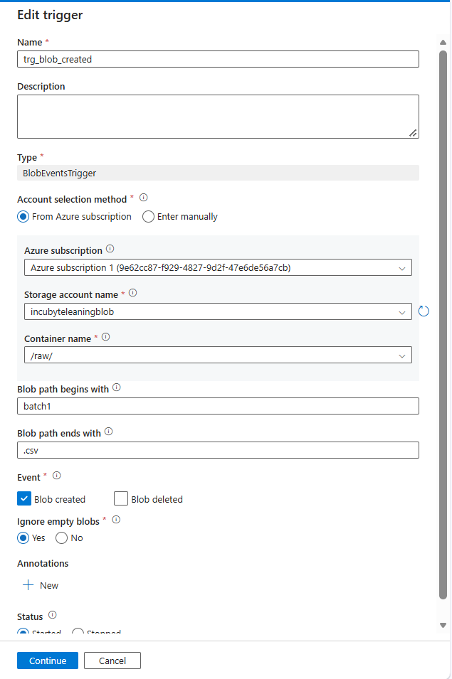
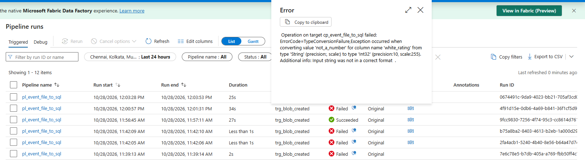

# Part 1 · Day 4 — Azure Data Factory In Depth

**Date completed:** 2026-10-28 · **Time spent:** ~7 hours

## Success criteria
| Criterion (copied from the planner)                    | Done? | Evidence (link or section below)                                                                          |
| ------------------------------------------------------ | ----- | --------------------------------------------------------------------------------------------------------- |
| Builds a parameterised Data Factory pipeline           | Yes   | [Batch pipeline with Lookup and ForEach](#batch-pipeline-with-lookup-and-foreach)                         |
| Uses ForEach and Lookup control flow                   | Yes   | [Batch pipeline with Lookup and ForEach](#batch-pipeline-with-lookup-and-foreach)                         |
| Chooses the right trigger type                         | Yes   | [Triggers](#triggers), [Storage event trigger](#storage-event-trigger)                                    |
| Monitors and reruns failed runs                        | Yes   | [Monitoring and reruns](#monitoring-and-reruns), [Failure and recovery](#failure-and-recovery)            |
| Compares Data Factory with AWS Glue and Step Functions | Yes   | [Data Factory compared with Glue and Step Functions](#data-factory-compared-with-glue-and-step-functions) |
| Reflects on porting a config-driven framework to Azure | Yes   | [Reflection](#reflection-on-config-driven-on-aws-if-done-on-azure)                                        |

## Key learnings
- Learnt how to setup a bit more complex pipelines with ADF.
- Learnt about the triggers and how to do it similar to S3 events on AWS.
- Spent quite a bit of time doing troubleshooting so got more hands on with Azure UI and things.
## Exercises
- Implemented a pipeline with lookup and foreach to handle multiple objects while fetching it from a control file.
- Created a storage event trigger for a pipeline to start whenever a new file drops in the target location
- Did failure and recovery exercise on how to deal with a failed pipeline
## Reflection
- The exercises were quite informative. As I ran into several problems and troubleshooted my way through, I learnt quite a lot of new things.
- I can see that ADF is a lot more of drag-and-drop tool than a mostly code one like glue or lambda. I feel that removes the fine control to it, but I think there are more things to explore here like Notebooks, Azure Databricks, and Azure Functions which can bridge this gap.
- A continuous observation is that the concepts map directly between AWS and Azure although in a different dialect. My predisposition to AWS makes me think that it is more vast, which it arguably is, but Azure also offers a lot of things.
## AI use
- Used Claude to organize and tidy up my rough notes into more well formatted markdown style.
- As this day was a lot more focused with doing hands-on, the notes making part was done more by Claude than me, as I had only made rough pointers of what I was doing.
## Open questions
NA
## Changes after review
NA

---
## Notes
### Parameters, variables and expressions
Three ways to hold values:
- **Parameters:** passed into a pipeline, dataset or linked service when it starts, and fixed for the run. Read with `@pipeline().parameters.name`.
- **Variables:** can change during a run through Set variable or Append variable. Read with `@variables('name')`.
- **Expressions:** formulas starting with `@`. They can read parameters, variables, activity outputs and system values.

Expressions used:

| Expression | Meaning |
| --- | --- |
| `@pipeline().parameters.sourceFolder` | A pipeline parameter |
| `@dataset().FileName` | A dataset parameter, used inside the dataset |
| `@item().file_name` | The current row inside a ForEach |
| `@activity('lk_file_list').output.value` | The array returned by a Lookup |
| `@pipeline().RunId` | Unique ID of the run |
| `@utcnow()` | Current UTC time |
| `@replace(pipeline().parameters.folderName, 'raw/', '')` | Strip the container name from a trigger folder path |

A dataset with parameters (`FolderName`, `FileName`) and a path built from `@dataset().FolderName` and `@dataset().FileName` can read any file, because the activity passes the values in. That is how one dataset serves many files.

### Control flow activities
- **Lookup:** reads a file or table and returns it. With **First row only** on, the result is `output.firstRow`. With it off, all rows come back as an array in `output.value`.
- **ForEach:** repeats activities for each item in an array. **Items** is an expression and `@item()` is the current element. **Sequential** runs one at a time, otherwise **Batch count** sets the parallelism (default 20).
- **If Condition:** one branch when an expression is true, another when false.
- **Set variable / Append variable:** change a variable.
- **Get Metadata:** file or folder details (exists, size, child items).
- **Execute Pipeline:** runs another pipeline, useful for splitting a large workflow.
- **Fail:** stops the run with a chosen message.
- **Wait / Until:** pause, or repeat until a condition is true.

### Triggers

| Trigger | Starts when | Best fit |
| --- | --- | --- |
| **Schedule** | At set times, such as hourly | Predictable timing. Fires whether or not data is present. |
| **Tumbling window** | At fixed, non-overlapping time windows | Time-sliced loads, backfills, dependencies between windows. |
| **Storage event** | A blob is created or deleted | Files arriving at unpredictable times. |

- Tumbling window runs expose `@trigger().outputs.windowStartTime` and `windowEndTime`, and can retry failed windows.
- Storage event triggers run on Event Grid, so the **Microsoft.EventGrid** resource provider must be registered on the subscription (Subscriptions > Resource providers).
- A storage event trigger can filter on **Blob path begins with** and **ends with**, and passes `@triggerBody().folderPath` and `@triggerBody().fileName` to the pipeline.
- `folderPath` includes the container name (e.g. `raw/batch1`).
- Blob Created fires once the blob is committed, so the partial-file concern from the Day 3 schedule notes does not apply to this trigger for normal uploads.

### Monitoring and reruns
Monitor has three views:
- **Pipeline runs:** one row per run with status, start and duration.
- **Activity runs:** the steps inside a run. The input and output icons show the detail and the error message.
- **Trigger runs:** each time a trigger fired and which run it started.

Recovering a failed run:
- **Rerun from failed activity:** restarts at the failed step without repeating steps that succeeded.
- **Rerun:** starts the whole pipeline again.
- **Retry** and **Retry interval** on an activity help with temporary errors (network blips). They do not fix bad data, because the same error repeats.
- **Alerts:** Monitor > Alerts, a rule on the pipeline-failed metric, routed to email.

### Data Factory compared with Glue and Step Functions
Data Factory covers the copy and orchestration roles that Glue and Step Functions split between them. Pipelines replace state machines and are more visual. Control flow maps closely: Map becomes ForEach, Choice becomes If Condition or Switch, Wait becomes Wait or Until, and nested state machines become Execute Pipeline.
- **Error handling:** Step Functions is stronger, with Retry and Catch fields per failure type. Data Factory sets retries per activity and handles failures by routing a red arrow to another activity.
- **Code:** Glue's PySpark does not port directly. The nearest options are Mapping Data Flows, Databricks or Azure Functions.
- **Catalog:** the biggest gap. Glue has a Data Catalog and crawlers, while Data Factory has no direct equivalent.
- **Triggers and inputs:** EventBridge schedules become schedule or tumbling window triggers, and S3 events become storage event triggers. Glue job parameters and Step Functions state input become pipeline and dataset parameters.

---
## Hands-on: practice and exercises
- **Practice:** [Batch pipeline with Lookup and ForEach](#batch-pipeline-with-lookup-and-foreach)
- **Exercise 1:** switch to a storage event trigger, see [Storage event trigger](#storage-event-trigger)
- **Exercise 2:** make a run fail and recover it, see [Failure and recovery](#failure-and-recovery)

### Batch pipeline with Lookup and ForEach
Setup: `games_a.csv` to `games_d.csv` in `raw/batch1/`, plus a control file `raw/control/files_to_load.csv` that lists them under a `file_name` header.

#### Datasets
- `ds_control_csv`: DelimitedText on `raw/control/files_to_load.csv`, comma delimiter, first row as header.
- `ds_raw_param`: DelimitedText on `ls_blob` with parameters `FolderName` and `FileName`. Container fixed to `raw`, **Directory** `@dataset().FolderName`, **File name** `@dataset().FileName`, Tab delimiter, header on.

#### Pipeline `pl_batch_raw_to_sql`
- Parameter: `sourceFolder` (default `batch1`).
- `lk_file_list`: Lookup on `ds_control_csv`, **First row only** off, then a green arrow to `fe_files`.
- `fe_files`: **Items** `@activity('lk_file_list').output.value`, Sequential off, Batch count 2.
- Inside the loop, `cp_file_to_sql`:
    - **Source:** `ds_raw_param` with **FolderName** `@pipeline().parameters.sourceFolder` and **FileName** `@item().file_name`. Additional columns: `source_file` (`$$FILEPATH`), `load_ts` (`@utcnow()`), `run_id` (`@pipeline().RunId`).
    - **Sink:** `ds_sql_stg`, table `dbo.stg_data`, table option **None**.
    - **Mapping:** left empty, so columns map by name at runtime.


*Pipeline `pl_batch_raw_to_sql`: Lookup feeding the ForEach that holds the copy.*

#### Verification
```sql
SELECT source_file, COUNT(*) AS rows_loaded
FROM dbo.stg_data
GROUP BY source_file
ORDER BY source_file;
```
Expected: one row per file, with counts matching each file's data rows.


*Verification query result: one row per file.*

#### Issues hit
- **ForEach inside an If Condition branch is not allowed.** The If Condition was unnecessary anyway, since a ForEach over an empty array runs zero times. Simplified to Lookup then ForEach.
- **"Failed to import source schema ... GetItemProfile".** A parameterised dataset has no fixed file, so Import schemas cannot read it. Left the mapping empty to map by name.
- **Validation errors "Container is required" and "wildcard file name is required".** The container has to be a fixed value on the dataset, and validation reads the dataset with no values passed in. Adding dataset parameter defaults gave validation a file to check.
- **"Property 'value' doesn't exist, available properties are firstRow".** **First row only** was still on in the Lookup. Turning it off returns the `value` array.
- **"Output of lk_file_list can't be referenced".** The ForEach was not connected after the Lookup. The arrow has to run from the Lookup to the ForEach on the main canvas.
- **404 on `games_*.csv`, then on `games_a.csv`.** The dataset's **Directory** box was empty, so the folder never reached the path. Fixed with dynamic content `@dataset().FolderName`.
- **Only `games_a.csv` loaded, once per iteration.** The file name was not coming from the loop, so the dataset default `games_a.csv` was used every time. Fixed by setting **FileName** on the copy to `@item().file_name` as dynamic content. A default that looks like a real value hides this kind of mistake, so dataset defaults should be cleared once the pipeline passes real values.

### Storage event trigger
The batch pipeline would reload every file in the control list whenever one file landed, so a separate single-file pipeline handles the event.

#### Pipeline `pl_event_file_to_sql`
- Parameters: `folderName` and `fileName` (String).
- `cp_event_file_to_sql`: source `ds_raw_param` with **FolderName** `@replace(pipeline().parameters.folderName, 'raw/', '')` and **FileName** `@pipeline().parameters.fileName`. Same additional columns and sink as before.
- The `replace` is needed because `folderPath` starts with the container name, and the dataset already sets the container.

#### Trigger `trg_blob_created`
- Manage > Triggers > New, type **Storage events**, the storage account, container `raw`.
- **Blob path begins with** `batch1/`, **ends with** `.csv`, event **Blob created**.
- Attached to `pl_event_file_to_sql` with `folderName` = `@triggerBody().folderPath` and `fileName` = `@triggerBody().fileName`.
- Activated, then Publish all.
- Test: uploading `games_d.csv` to `raw/batch1/` started a trigger run that loaded that file once.


*Trigger `trg_blob_created`: container, path filters and Blob created event.*

#### Issues hit
- **Trigger asked for parameter values when attached.** Each pipeline parameter needs an expression that reads the trigger output, entered as dynamic content.
- **"Missing parameter definition for 'sourceFolder'".** A reference to the batch pipeline's parameter survived in the event setup, and it did not show in the pipeline or trigger code. I rebuilt the event pipeline and trigger, and the error cleared after checking the shared dataset `ds_raw_param` and refreshing Studio.

### Failure and recovery
- Created `games_bad.csv` with one `white_rating` changed to `not_a_number` and uploaded it to `raw/batch1/`.
- The trigger fired and the run for that file failed with a conversion error that names the row and column.
- The other files were unaffected, since each file gets its own run.
- Recovery: fixed the value and uploaded the file again with **Overwrite**. Overwriting fires a new Blob Created event, so a new run started and the file loaded once.
- I also used **Rerun from failed activity** in Monitor > Pipeline runs, with the same result.



*The failed run for `games_bad.csv` in Monitor, with the error message.*

---
## Reflection on Config driven on AWS if done on Azure

On AWS, a central config table held one row per source (S3 target, file type, Salesforce object/file name/database details), and a Databricks job read it, called the Salesforce Bulk API/file mover function/database call and wrote to S3, with an instance profile handling access. In Data Factory the config table would live in Azure SQL Database, and a master pipeline would run a **Lookup** over the active rows, a **ForEach** over the result, and a **Switch** on `source_type` that calls one of three child pipelines (Salesforce, file, database) through **Execute Pipeline**, passing the row values as parameters.

The child pipelines would use parameterised datasets, like the `ds_raw_param`, so the target container, path, format and source object all come from the config row, and adding a source means inserting a row rather than building a pipeline. The AWS pieces map across: ADLS Gen2 replaces S3, a managed identity replaces the instance profile, Key Vault replaces Secrets Manager, and schedule, tumbling window and storage event triggers replace the scheduling and file-arrival logic.