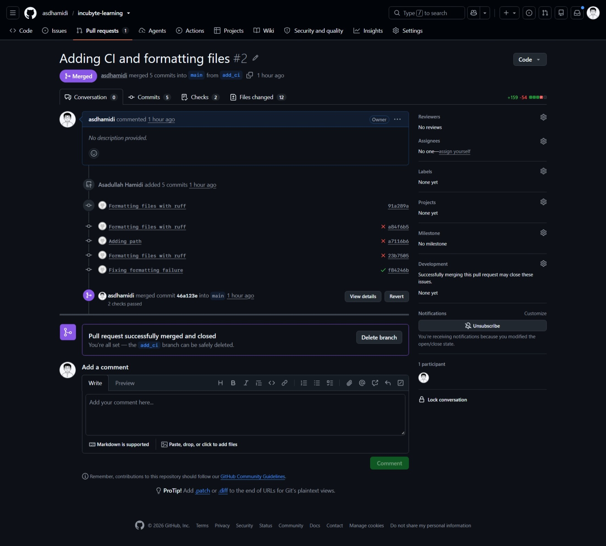
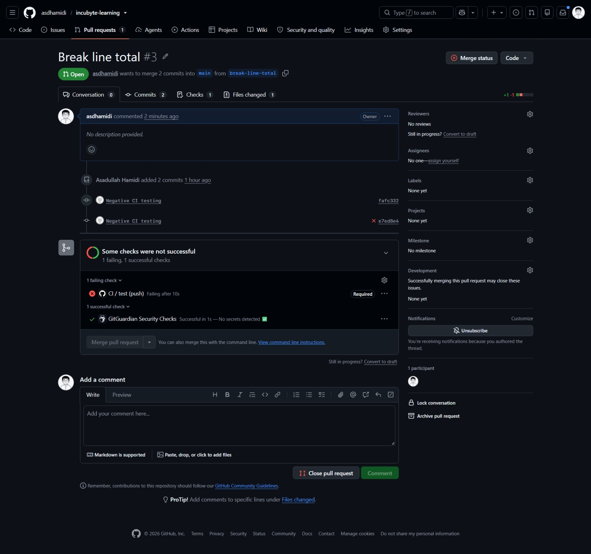

# Part 1 · Day 7 — CI/CD & Git for Data

**Date completed:** 2026-11-03 · **Time spent:** ~5 hours
## Success criteria
| Criterion (copied from the planner)                                                         | Done? | Evidence (link or section below)                                                                                                                                                           |
| ------------------------------------------------------------------------------------------- | ----- | ------------------------------------------------------------------------------------------------------------------------------------------------------------------------------------------ |
| Works with branches and small commits and pull requests                                     | Yes   | [Git workflow for data code](#git-workflow-for-data-code), [Pull requests](#pull-requests), [PR #2](../assets/day7/day7_ci_setup_and_pass.jpeg), [PR #3](../assets/day7/day7_ci_fail.jpeg) |
| Reviews a teammate's data change constructively                                             | Yes   | [Reviewing a teammate's data change](#reviewing-a-teammates-data-change), [PR](../code/part1/day7/exercise-1/pr-to-review.md), [review](../code/part1/day7/exercise-1/review.md)           |
| Explains continuous integration for data code                                               | Yes   | [Continuous integration](#continuous-integration)                                                                                                                                          |
| Knows what checks belong in CI for SQL and Python                                           | Yes   | [What to run in CI](#what-to-run-in-ci)                                                                                                                                                    |
| Runs tests automatically on every push                                                      | Yes   | [CI pipeline with GitHub Actions](#ci-pipeline-with-github-actions), [Making CI block merges](#making-ci-block-merges), [ci.py](../ci.py), [ci.yml](../.github/workflows/ci.yml)           |
| Applies DORA metrics to data delivery                                                       | Yes   | [DORA metrics](#dora-metrics)                                                                                                                                                              |
| Reflection: what would deployment frequency and change failure rate look like for your team | Yes   | [Reflection](#reflection-on-ci)                                                                                                                                                            |

## Key learnings
- Setting up CI on a repo to automate manual checks.
- Setting up ruleset to create checkpoints when merging PRs.
- Reviewing PRs and leaving meaningful comments.
## Exercises
- Setting up CI with Github workflows on the repo
- Setting up rulesets on branches
- Doing negative testing of a CI to see if it catches a problem
## Reflection
I had used Github actions for CI before but never set it up manually. This was a nice module on it to see how it works on different cases. I set it up with ruff and pytest which created a really useful tool as well.
## AI use
- For guiding in creating the CI for github actions
- For formatting the notes.
## Open questions
NA
## Changes after review
NA

---
## Notes

### Git workflow for data code
SQL, pipeline code and tests are all code, and a bad change to a shared table reaches every report that reads it. A pull request (PR) is the checkpoint where automated checks and a second person look at a change before it lands.

| Command | Does |
|---|---|
| `git switch -c <branch>` | Create and move to a branch |
| `git add -p` | Choose which changes go in the commit |
| `git push -u origin <branch>` | Publish the branch |
| `git log --oneline --graph` | See the history |
| `git diff --stat main..<branch>` | Files changed against `main` |
| `git revert <commit>` | Undo one commit with a new commit |

Repo hygiene - a `.gitignore` (`.venv/`, `__pycache__/`, `.pytest_cache/`, `*.duckdb`, `.env`), no credentials or real data in the repo, only small fixtures, and schema changes in their own PR.

### Pull requests
- A PR is a proposal to merge a branch plus the discussion around it. A draft PR is a way to ask for early feedback before the work is finished.
- Keep the diff to one concern, and read my own "Files changed" tab before asking anyone else.
- For a data change the description should have: what and why, how it was tested, downstream impact (tables and reports that read it), rollback, and what the reviewer should look at.
### Continuous integration
Every push triggers an automated build on a clean machine, so integration problems show up within minutes. Fowler's practices include a self-testing build, a build on every push to mainline, fixing broken builds immediately, keeping the build fast (around ten minutes), and testing in a clone of production.

CI can't use production data (slow, costly, sensitive and always changing), so it runs the code against small fixed sample data in a throwaway database.

| | CI checks | Pipeline data tests |
|---|---|---|
| Question | Is my code correct? | Is today's data OK? |
| Data | Fixtures and sample files | Real tables |
| Runs | Every push | Every load |

### What to run in CI
Cheapest first, so failures arrive in seconds.

| # | Check | Tool | Catches |
|---|---|---|---|
| 1 | Forbidden files | Short script | Databases, extracts, secrets committed |
| 2 | Formatting | `ruff format --check`, `black` | Noisy diffs |
| 3 | Lint | `ruff check`, `sqlfluff` (SQL) | Unused imports, SQL issues |
| 4 | Compile or parse SQL | `sqlfluff parse`, `EXPLAIN`, `dbt compile` | Typos, broken references |
| 5 | Unit tests | `pytest` | Transformation logic |
| 6 | Contract tests on sample payloads | `pytest` | Samples drifting from the contract |
| 7 | Component and data tests on fixtures | `pytest` + in-memory DuckDB | SQL logic, null and unique rules |
| 8 | Flow test (slower) | Small end-to-end run in dev | Wiring between steps, often on merge or nightly |
| 9 | Secret scanning | gitleaks or similar | Keys in code |

Principles - one entry point that runs the same locally and in CI, fast, deterministic, isolated, clear failure messages, and a red `main` stops the line.

### Promoting changes across environments

| Environment | Answers | Data | Deployed by |
|---|---|---|---|
| Dev | Does it run? | Small samples or synthetic | Me |
| Test | Is it correct on realistic data? What will it change? | Copy of prod, masked | Automatically after CI |
| Prod | Real use | Real | Only CI, after approval |

- Promote the same commit through the environments. Only configuration differs (target schema, connection, credentials). Nobody edits prod by hand, and secrets live in the CI secret store.
- Personal data gets masked before it reaches dev or test. Warehouses can make a test copy cheaply (Snowflake can clone a database without copying the data, and on Azure SQL a copy can be restored).
- Flow is PR with CI on samples, merge, dev, test (deploy, run, compare with prod), approval, then prod.
### Schema changes need a second reviewer
Code rolls back by redeploying, but data and structure often can't, and every reader depends on a table's names, types and meaning.

- Changing `amount` from `DOUBLE` to `INTEGER` raised no error and revenue became 441. Changing the type back left it at 441.0, so the cents were gone for good.
- Renaming the column broke the existing query (`Binder Error: Referenced column "amount" not found`), and it would break every reader outside the PR too.

| Change | Risk |
|---|---|
| Add a nullable column | Low |
| Add a `NOT NULL` column with no default | Medium (writers fail) |
| Rename a column or table | High (breaks every reader) |
| Drop a column | High, irreversible |
| Change a type | High (silent truncation or failed casts) |
| Change the meaning, keeping name and type | Highest (nothing fails, no test notices) |

Expand, migrate, contract avoids breaking readers - add the new column and backfill it, move every reader across, then drop the old column once nothing reads it. 
Reviewer checklist: who reads it (lineage, other teams), backwards compatibility, data loss risk, migration and rollback (reverting code doesn't revert data), size and lock time, tests for the new shape, and who has been told. The author is the person least likely to know about the other readers.
### DORA metrics
There are five - deployment frequency, lead time for changes, failed deployment recovery time, change fail rate and deployment rework rate. The first three are about throughput and the last two about instability.

| Metric | Measure |
|---|---|
| Deployment frequency | Prod deployments per week |
| Change lead time | First commit to prod |
| Failed deployment recovery time | Restore time minus deploy time, for failed deploys |
| Change fail rate | Failed deploys divided by all deploys |
| Deployment rework rate | Unplanned fix deploys divided by all deploys |
- Recovery time now only covers failures a deployment causes, and rework rate catches a deploy that needed no rollback but still forced an unplanned follow-up.
- For data, a deployment is a change reaching prod (pipeline code, model, migration, config), not a scheduled run. A failure is a rollback, hotfix or immediate fix. The numbers come from Git, CI/CD history and the incident log.
---
## Hands-on: exercises
- **Exercise:** review a teammate's data change, see [Reviewing a teammate's data change](#reviewing-a-teammates-data-change)
- **Practice:** CI that runs the Day 5 tests on every push, see [CI pipeline with GitHub Actions](#ci-pipeline-with-github-actions)
- **Exercise:** break a test on purpose and watch the pipeline block the change, see [Making CI block merges](#making-ci-block-merges)

### Reviewing a teammate's data change
Files: [`pr-to-review.md`](../code/part1/day7/exercise-1/pr-to-review.md) (the PR), [`review.md`](../code/part1/day7/exercise-1/review.md) (my review)

The exercise PR was a revenue-by-currency summary. CI was green (18 tests passing), but the change was not ready.

`f2` run on the two sample orders returned `[('USD', 44), ('ALL', 44)]`, while the true figures were USD 44.48 and EUR 15.00. Running the code on the sample data and reading the output is what showed it - reading the diff alone would have missed it.

| Issue found | Category | Severity |
|---|---|---|
| Hard-coded `WHERE order_id <> 'O-1002'` hid the only EUR order, so EUR vanished | Logic | Blocking |
| `ALL` total added USD and EUR together, which is meaningless without conversion | Logic | Blocking |
| `CAST(... AS INTEGER)` dropped the cents | Logic | Blocking |
| A 536 KB `dev.duckdb` was force-committed past `.gitignore` | Hygiene | Blocking |
| Test only asserted `len(rows) > 0`, so it passed on wrong numbers | Tests | Blocking |
| Recomputed `unit_price * qty` instead of using `line_total` (rule in two places) | Logic | Suggestion |
| Total row mixed into the data rows, so summing the output double counts | Design | Suggestion |
| `f2`, `cur`, `amt`, `'ALL'` were cryptic names | Naming | Suggestion |
| Commit `stuff` and description "pls review" | PR hygiene | Suggestion |
| Unrelated rename in `contract.py` | Scope | Suggestion |
| Test name, placement and import inside the function | Tests | Nit |

What a review comment needs:
- Where - the file and line.
- Category (logic, naming, tests or other) and severity (blocking, suggestion or nit).
- What I see, in one specific sentence.
- Why it matters, meaning the consequence for the data or readers.
- What I would do - a suggestion, or a question when I'm not sure.

Other points:
- Comment on the code, not the person, and ask when unsure ("what was wrong with O-1002?").
- Finish with a verdict (approve, request changes or comment) and name one thing done well.
- "Only one test" is the wrong comment. The problem was the assertion, so say what the test should check.
- More comments don't fix unclear code. Better names and a docstring do.

### CI pipeline with GitHub Actions
Files: [`ci.py`](../ci.py), [`.github/workflows/ci.yml`](../.github/workflows/ci.yml), [`requirements.txt`](../requirements.txt)

`ci.py` is Python so it runs the same on Windows, Mac and Linux. It runs four stages in order - forbidden files, format, lint, tests.

In the demo, the stages failed in order on a branch:
- A committed `dev.duckdb` with the tests untouched stopped at stage 1 (`data files must not be committed`) and never ran the tests. This is the problem from the review exercise, caught automatically.
- Badly formatted code stopped at stage 2.

`ci.yml`:

```yaml
name: CI
on:
  push:
  workflow_dispatch:
jobs:
  test:
    runs-on: ubuntu-latest
    timeout-minutes: 10
    steps:
      - uses: actions/checkout@v7
      - uses: actions/setup-python@v6
        with:
          python-version: "3.12"
          cache: pip
      - run: pip install -r requirements.txt
      - run: python ci.py
```

- `requirements.txt` pins exact versions (`pytest`, `duckdb`, `ruff`) so builds are repeatable.
- `on: push` alone avoids the double runs that `push` plus `pull_request` causes, and `workflow_dispatch` adds a manual button.
- The job name (`test`) is the check name used in the ruleset.
- If an action version can't be resolved, use the latest tag on the action's page.
- A CI failure can be reproduced locally with `python ci.py`.



*PR #2 "Adding CI and formatting files": the formatting commits fail the check, then the fix passes and the PR merges.*

### Making CI block merges
A check that can be ignored doesn't protect `main`. The ruleset is under Settings, Rules, Rulesets, new branch ruleset. It targets `main`, requires a pull request with 0 required approvals (a solo repo can't approve itself), requires the status check `test` (it only shows in the list after one run), and blocks force pushes.

Rulesets are available for public repositories on GitHub Free, and for public and private ones on Pro, Team and Enterprise Cloud. A private repo on Free can't enforce them, so either make the repo public (with no secrets or real data) or follow the rule by hand.

Break-on-purpose exercise - the three failures and where each stops:

| Break | Stage that fails | Notes |
|---|---|---|
| Wrong `line_total` logic | 4, tests | Assertion shows expected and received values |
| Sample file with `customer.id` renamed | 4, contract boundary test | Only that file's test fails, with the field named |
| Committed database or bad formatting | 1 or 2 | Fails in seconds, tests never run |

Each goes green after a fix commit on the same branch, and the PR reruns the check automatically.



*PR #3 "Break line total": the required `CI / test` check fails, so the merge button stays disabled.*

## Reflection on CI
A deployment is a merge to `main` or `qa` that ships pipeline code, a model or a migration to prod or qa, not a scheduled run. With small PRs and CI on every push, I’d expect about 3-5 a week, with schema changes rarer at 1-2 a month because each needs a second reviewer.

A failure is a deploy that needed a revert or hotfix because of the change itself, such as a bad join or a type change that truncated values. I’d estimate 2 in 10 changes, mostly schema or join changes, which CI on sample data catches less well. Upstream data problems, like a new status value, don’t count here and I’d track them as separate data incidents.
