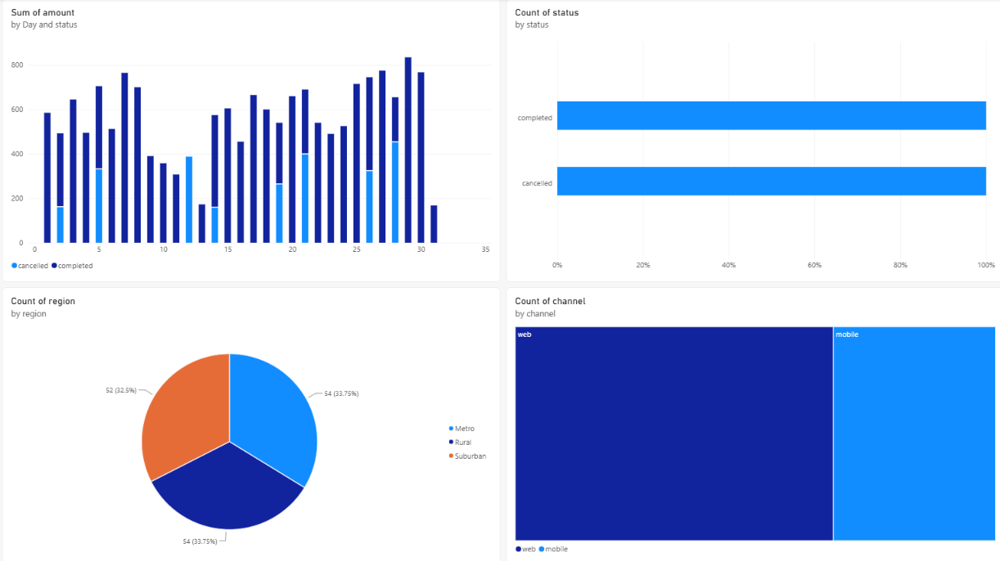

# Part 1 · Day 8 — Analytics for Stakeholders

**Date completed:** 2026-11-04 · **Time spent:** ~3.5 hours
## Success criteria
| Criterion (copied from the planner)                                                  | Done? | Evidence (link or section below)                                                                                                                                                                                          |
| ------------------------------------------------------------------------------------ | ----- | ------------------------------------------------------------------------------------------------------------------------------------------------------------------------------------------------------------------------- |
| Turns a stakeholder question into a data requirement                                 | Yes   | [The analytics side of the role](#the-analytics-side-of-the-role), [Turning a question into a requirement](#turning-a-question-into-a-requirement), [Practice: how are renewals doing?](#practice-how-are-renewals-doing) |
| Writes a metric definition with grain and filters and time window                    | Yes   | [Metric definitions](#metric-definitions), [renewal rate definition](#practice-how-are-renewals-doing)                                                                                                                    |
| Builds a repeatable query and view                                                   | Yes   | [Repeatable queries and views](#repeatable-queries-and-views), [Exercise: view and hand check](#exercise-view-and-hand-check), [code](../code/part1/day8/explore.py)                                                      |
| Spots misleading aggregates such as Simpson's paradox                                | Yes   | [How averages and aggregates mislead](#how-averages-and-aggregates-mislead)                                                                                                                                               |
| Understands Power BI at a working level                                              | Yes   | [Power BI at a working level](#power-bi-at-a-working-level), [Power BI report](#power-bi-report), [report](../assets/day8/powerbi_report.png), [dataset](../assets/day8/orders_sample.csv)                                |
| Answers a stakeholder answer-first with evidence and caveat                          | Yes   | [Exercise: the three-sentence answer](#exercise-the-three-sentence-answer), [code](../code/part1/day8/explore.py)                                                                                                         |
| Reflection: where has a metric been read differently by two people in your past work | Yes   | [Reflection](#reflection-on-metric-confusion)                                                                                                                                                                             |

## Key learnings
- Learnt about Simpson's paradox where trends disappears when grains are combined
- Learnt about creating a framework to define a metric
- Learnt about how to structure a request by asking clarifying questions so that there is no disambiguity.
## Exercises
- Created sample tables with Claude, and then did deep dive into exploring the data to answer a questions.
- Created a sample PowerBI report using a sample data file
## Reflection
- The concept of a framework for metric definition is definitely gamechanger and would help a lot.
- The practice of asking clarifying question is really important in all scenarios when it comes to data.
## AI use
- Used Claude to format the notes.
- Used Claude code to generate the data setup for the exercise.
- I was a bit unsure with my SQL query so got them checked by Claude to be sure.
## Open questions
Can you share more such articles like Simpson's paradox and about stakeholder communication on data?
## Changes after review
NA

---
## Notes

### The analytics side of the role
A stakeholder's question is usually about business or non-technical. The ask is usually to turn it into a precise specifications before writing any SQL. Most "wrong numbers" are two definitions clashing.

Example: One table of 18 October orders and one question, "what was our on-time delivery rate in October?". The four reasonable definitions:

| Result | Definition                                                                           |
| ------ | ------------------------------------------------------------------------------------ |
| 50.0%  | On time ÷ all orders placed in October (cancelled and in-transit in the denominator) |
| 60.0%  | On time ÷ delivered orders placed in October                                         |
| 61.5%  | On time ÷ orders delivered in October (window on the delivery date)                  |
| 80.0%  | As the 60% version, with one day of grace                                            |
None of them are incorrect per se, but the definition was never clear, hence this confusion.
### Turning a question into a requirement
Each metric can be clarified by asking questions about it which will clear it up.

| Dimension            | Question                                                |
| -------------------- | ------------------------------------------------------- |
| The decision         | What will you do with this number?                      |
| The unit             | Per order, parcel or customer?                          |
| The population       | Which rows count (cancelled, returns, in transit)?      |
| The time             | Which date puts a row in a period, and which time zone? |
| Success              | What counts as "on time" or "renewed"?                  |
| Comparison and slice | Against what, split by what?                            |
| Edge cases           | What if the promise date changed?                       |
| Freshness            | How often, and is a late correction acceptable?         |
### Metric definitions
A definition has to let two people produce the same number, so it gets written before the SQL. A framework to define a definition.

| Field | States |
|---|---|
| Name | Specific (`on_time_delivery_rate_by_delivery_month`) |
| Question / decision | What it supports |
| Definition | One sentence |
| Row grain | One row per what in the underlying data |
| Output grain | One number per what (month, plan) |
| Numerator and denominator | Exactly which rows count in each |
| Filters | Inclusions and exclusions, and why |
| Time window | Date field, time zone, boundaries |
| Edge cases | Cancelled, nulls, changed promises |
| Source and owner | Table and who answers questions |
| Caveats | What a reader could misread |
### Repeatable queries and views
A repeatable query answers the same question every week without anyone editing it. That means no hard-coded dates, since a fixed date range keeps returning the same rows with no error. Every date comes from one reference-date view that returns the current date in production and a fixed date in tests. 

Rules of thumb:
- Keep the business rule and the metric in separate layered views, use explicit columns, comment the definition, and keep the view scripts in Git. 
- A view is a named query that always runs fresh, so start with a plain view and move to a scheduled table or a materialized view only when it gets slow or costly. 
- Materialized views have limits (reportedly a single base table, no joins, and possibly an edition requirement), so check the current docs. 
- Grant access to the view and not the base tables, and use a secure view if the definition should stay hidden.
### How averages and aggregates mislead
An aggregate squeezes many rows into one number and can hide what is underneath.

Simpson's paradox is when a trend shows up in several groups but disappears or reverses once the groups are combined.

| Carrier | Overall on time | Metro           | Rural            |
| ------- | --------------- | --------------- | ---------------- |
| A       | 63.5%           | **95%** (of 20) | **60%** (of 180) |
| B       | **86.0%**       | 90% (of 180)    | 50% (of 20)      |

- A is better in both regions and worse overall, because 90% of A's volume is Rural and only 10% of B's.
- An overall rate is a weighted average of the subgroup rates, and the weights differ between the groups. The cause is a confounding variable that affects both the group and the outcome, here the region.
- Like for like, at a 50/50 mix A is 77.5% and B is 70.0%.
- The real question is which data to use when choosing an action, the aggregated or the split one. That depends on why the groups differ, so it's a judgement call.

Checks before finalizing a number:
- Split by the obvious segments and see if the direction flips.
- Show counts next to rates.
- Compute rates from sums.
- Compare like with like, or state the mix.
- When a total moves, ask what moved underneath - the mix or the rate.

### Power BI at a working level
Power BI turns warehouse data into reports: we can connect a source such as Snowflake or a file in Desktop, define metrics, dashboards, and reports.
### Power BI report
Files: [`orders_sample.csv`](../assets/day8/orders_sample.csv) (the data, 160 orders over 8 weeks), [`powerbi_report.png`](../assets/day8/powerbi_report.png) (the report)

I loaded the CSV into Power BI Desktop and built one page with four visuals:
- Sum of amount by day, split by status (completed and cancelled).
- Count of orders by status.
- Count of orders by region (Metro 54, Rural 54, Suburban 52).
- Count of orders by channel (web and mobile).

*One-page report on `orders_sample.csv`.*

---
## Hands-on: practice and exercises
Code: [`setup.py`](../code/part1/day8/setup.py) builds the data in `renewals.duckdb`, and [`explore.py`](../code/part1/day8/explore.py) has the view, the checks and the answer. The Power BI part is under [Power BI report](#power-bi-report).
### Practice: how are renewals doing?
The request was vague, so the clarifying questions came first, then the definition, before any SQL.
- **Decision:** is the 90% renewal target on track, and should Q4 add CS headcount?
- **Definition:** renewed subscriptions as a share of decided renewals due in the quarter (renewed ÷ (renewed + churned)).
- **Grain:** one row per subscription renewal, and one rate per quarter and plan.
- **Filters and window:** trial plans excluded, `renewal_due_date` in the quarter, as of 28 Oct 2026.
- **Edge cases:** early cancellations count as churned. Pending more than 30 days past due counts as churned, and within 30 days it is open and left out of the rate.
- **Caveat:** open renewals can still move the rate, and a change in plan mix can move the headline on its own.

### Exercise: view and hand check
The view `v_renewal_rate_by_quarter` classifies each renewal as renewed, churned or open, aggregates by quarter and plan, and computes the rate from sums. Its date comes from `v_as_of`.

| Quarter | Plan | Rate |
|---|---|---|
| Q2 | all | 88.0% |
| Q3 | enterprise | 96.0% |
| Q3 | smb | 64.0% |
| Q3 | all | 72.0% |
- Hand check: the 26 Q3 enterprise rows tally to 24 renewed, 1 churned and 1 pending. The pending row is 29 days past due, so it's open. 24 ÷ 25 = 96.0%, which matches the view, and it tests the 30-day boundary.
- Common wrong Q3 rates: 72.8% if trials aren't excluded, 69.2% if all pending count as churn, and 74.2% if all pending are ignored.
### Exercise: the three-sentence answer
> Q3 renewals were 72%, down from 88% and below the 90% target, but it’s a mixed shift (SMB went from 20 to 75 of 100 decided renewals) and not worse performance, as both plans improved. SMB at 64% is the real gap, so headcount should rest on SMB. Four renewals are still open and could move Q3 between 69.2% and 73.1%.
## Reflection On Metric Confusion
- Once I was working on a ESG metric about employee commute, while discussing the definition I received the definition that the emissions should be calculated at a "region" level. At that time, I had gone ahead with thinking the region here would mean country, but later, it was flagged that region would mean region at each level from province/state to country to continent to region (EMEA, NA, SA, etc)